<div align="center">

<a href="https://rotten-guy.github.io"></a>

<a href="https://rotten-guy.github.io"></a>
<a href="https://github.com/rotten-guy/dotfiles"></a>
<a href="https://www.keybr.com/profile/752ae7r"></a>
<a href="https://monkeytype.com/profile/rotten_guy"></a>
<a href="https://www.root-me.org/rotten-guy?lang=en"></a>

</div>

---

## ✨ whoami

| | | |
|---|---|---|
| 🎓 | **Studying** | BUT Networks & Telecoms (R&T) at the IUT of Montbéliard |
| 🐧 | **Daily driver** | Arch Linux + Hyprland, a neon cyan / magenta rice called **Nebula** |
| ⌨️ | **Typing on** | A wireless Lily58 running my own ZMK firmware, with a bongo cat on the screen |
| 🎯 | **Training** | Root-Me (security) and typing on keybr / Monkeytype, live stats below |
| 🌐 | **Portfolio** | [rotten-guy.github.io](https://rotten-guy.github.io), the same theme as a website (press `K` there) |

---

## 🗂️ Projects

<a href="https://github.com/rotten-guy/dotfiles"></a>
<a href="https://github.com/rotten-guy/rotten_lily58_keymap_config"></a>
<a href="https://github.com/rotten-guy/rotten-guy.github.io"></a>
<a href="https://github.com/rotten-guy/dotfiles/tree/main/docs"></a>

---

## 🎯 Training

<a href="https://www.root-me.org/rotten-guy?lang=en"></a>
<a href="https://www.keybr.com/profile/752ae7r"></a>

<a href="https://monkeytype.com/profile/rotten_guy"></a>

<a href="https://rotten-guy.github.io/#skills"></a>

---

## ⌨️ Skills


---

## 📊 Stats


<sub>Redrawn every day by <a href=".github/workflows/stats.yml">GitHub Actions</a>, no third-party stats service.</sub>

---

<details>
<summary>🔧 How this profile is made</summary>

<br>

Every picture is an SVG drawn by a Python script, in the colors of the [Nebula rice](https://github.com/rotten-guy/dotfiles): background `#070914`, cyan `#00f0ff`, magenta `#e600ff`, fonts JetBrains Mono and Outfit. Text is turned into paths (`fontTools`) so it looks the same on every machine, and the borders spin like the Hyprland ones.

```bash
pip install fonttools
python3 scripts/make-cards.py                          # banner, cards, skills
python3 scripts/make-logo.py                           # logos
python3 scripts/make-stats.py --sample /tmp/stats.svg  # stats preview with made-up numbers
python3 scripts/make-training.py --sample /tmp/training # typing / Root-Me preview with made-up numbers
```

| File | Purpose |
|---|---|
| `scripts/nebula.py` | Palette, text-to-path, starry background, animated border, keycaps |
| `scripts/make-cards.py` | `banner.svg`, the `card-*.svg` and `skills.svg` |
| `scripts/make-logo.py` | `assets/logo/`: the personal logo (`avatar-*`, "rotten / guy>_") and the website logo (`site`, ">_"), with 1024 px PNG exports |
| `scripts/make-training.py` | `training.json`, `typing.svg` (the Lily58 typing three phrases at my real speed), `activity.svg`, `card-typing.svg`, `card-rootme.svg`, from keybr, Monkeytype and Root-Me (run by the same workflow) |
| `scripts/make-stats.py` | `stats.svg` from the GitHub API (run by `.github/workflows/stats.yml`) |
| `scripts/fonts/` | JetBrains Mono and Outfit (SIL Open Font License) |

</details>
